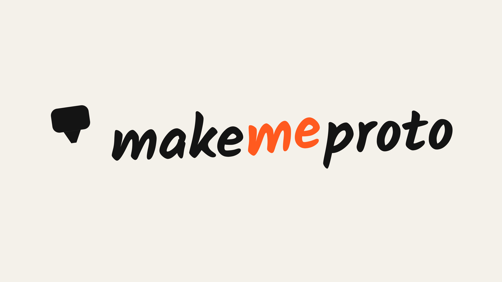

<p align="center"></p>

# MakeMeProto website

**Socho. Design Karo. Print Karo.** · 3D design & 3D printing, Ahmedabad

A one-page website for MakeMeProto (3D design & 3D printing services). Plain HTML, CSS and JavaScript, with nothing to install.

## Files

```
MakeMeProto/
├── index.html        ← home: hero + printer, what we make, how it works, why us, work, contact strip
├── pricing.html      ← instant STL quote, price examples, materials
├── services.html     ← all services, "who are you?" tabs, broken-part repair, full work gallery
├── guide.html        ← design tips + FAQ
├── community.html    ← 3D Adda
├── about.html        ← the two makers, rules, why us
├── contact.html      ← contact form + details
├── _layout/          ← shared nav, footer and floating buttons (edit here, then run tools/layout.py)
├── css/style.css     ← colours, fonts, layout
├── js/main.js        ← your contact details, prices, quote calculator
├── tools/            ← layout.py (sync shared layout), publish-preview.sh (test site)
├── assets/brand/     ← 4K logos, icon, animated logo, Kalam font
└── README.md
```

## See it

Double-click `index.html` and it opens in your browser.

## Before you go live (10 minutes)

1. **Your details:** open `js/main.js` and edit `CONFIG` at the top:
   - `whatsapp`: country code + number, digits only, e.g. `"919876543210"`
   - `phoneText`, `email`, `city`, `cityFull`, `instagram`
2. **Prices:** in the same `CONFIG`, change `rate` (₹ per gram) for each material, plus `minOrder` and `maxSizeMm` (set it to your printer's real build size).
3. **Text:** check these lines in `index.html` match what you actually offer:
   - delivery time ("2–4 din"), max print size in the FAQ, "Happy to sign an NDA", design price "From ₹300 / hour"
4. **Our work section:** the six tiles are drawings. Once you have real print photos, replace a tile's `<div class="tile__art">…</div>` with
   `<div class="tile__art"></div>`
   and put the photo in an `images/` folder. Then remove "Real photos of our prints coming soon."
5. **"Hum kaun?" section (`id="makers"`):** names, roles and LinkedIn links are set for Deepak Dadheech (mechanical/printing) and Bal Krishan Swami (software/design). The faces are cartoon drawings; you can swap each `<div class="maker__art">…</div>` for a real photo the same way as step 4. Also check the promises you're making: "step 3½: we WhatsApp you a photo while it prints" and "replies within a few hours".

## The hero printer (playground)

- Mouse over the printer: move up/down to add or remove layers. The nozzle follows left/right and the printer tilts.
- Click the printer or "▶ Print from scratch" to watch a full print, with sparks and a "Ho gaya!" bubble at the end.
- Model buttons (Vase, Kulhad, Rocket, Dil), "Apna naam…" prints any name, and the colour dots swap filament.
- On phones: tap to print, drag sideways to scrub.
- To add a shape, add a function to `SHAPES` in `js/main.js` and a button with `data-model="yourKey"`. The bubble messages are in `phrases`.

## How the instant quote works

- STL files are read **inside the visitor's browser**. Nothing is uploaded anywhere.
- Weight = model volume × material density × fill factor (walls + infill %).
- Price = weight × ₹/gram × quantity (infill changes the weight; colour doesn't change the price), shown as a −10% / +15% range, never below the minimum order.
- "Send this quote on WhatsApp" opens WhatsApp with all the details filled in. The customer sends the file there.

It's an estimate. Check every file before you confirm the final price.

## Putting it online (free hosting)

Any of these work. Upload the whole folder:

- **Netlify Drop:** go to app.netlify.com/drop and drag the `MakeMeProto` folder onto the page. You get a live link in seconds.
- **Cloudflare Pages** or **GitHub Pages:** free, and both can use your own domain.

Then connect your domain (e.g. `makemeproto.in`) in the host's "Custom domain" settings, and add the DNS records it shows you at your domain registrar.

## Changing the look

All colours and fonts are at the top of `css/style.css` under `:root`:
`--accent` (orange), `--ink` (black), `--paper` (background), `--mint` (green).

## Colours (the 🎨 "Rang badlo" button)

The site uses orange (Filament). The 🎨 button is switched off, but five palettes are still built in: **Filament** (orange), **Neem** (green), **Neela** (blue), **Gulabi** (pink), **Jamun** (purple). To try them again, set `showThemeSwitcher: true` in `js/main.js`.

Once you've picked one, open `js/main.js` and set it in `CONFIG`:

```js
theme: "neela",
showThemeSwitcher: false,   // hides the 🎨 button for visitors
```

To make your own palette, copy one of the `[data-theme="…"]` lines at the top of `css/style.css` and change the colours.

## Handwritten touches & Proto

- Handwritten notes use the Caveat font; the logo uses Kalam. Both load from Google Fonts when online.
- Marker highlight: wrap words in `<span class="hl">…</span>`. Hand-drawn circle: `<span class="circle-word">…</span>`.
- **Proto** is the little orange cube that peeks over the contact form. His eyes follow the mouse, and clicking him changes what he says. His lines are in `initProto()` in `js/main.js`.

## Getting a price quickly

- **Upload STL, get price** button at the top opens the file picker and jumps to the price.
- Drag an STL file **anywhere on the page** and a "Chhod do! 📦" box appears; drop it to get the price.
- **Try a sample** button in the quote section lets people test the calculator without a file (it's labelled as a sample).
- A small **⚡ Instant price** pill appears at the bottom left while scrolling.

## Logo & brand assets

Ready-made 4K files are in `assets/brand/` (transparent, white, cream and dark PNGs, a square icon, and animated GIF/MP4). The Kalam font used for the wordmark is in `assets/brand/fonts/` (SIL Open Font License, see `OFL.txt`).

The logo is a small nozzle "writing" the name: the orange line under `makemeproto` is filament from the nozzle and draws itself on load and hover. It's built from code (`.logo` in `index.html`), so it stays sharp everywhere. For social media you'll want a PNG version as well.

## Sections (in order)

Services → **Kiske liye?** (tabs: student, engineer, shop, home, gift) → How it works → Instant quote → **Kitne ka padega?** (example prices, worked out live from `CONFIG` so they always match the calculator) → Materials → **Toota part? Mat phenko.** (before/after slider) → Our work → Hum kaun? → **Deepak ki diary** (STL tips) → Why us → **Reviews? Abhi zero.** → FAQ → Contact

Things to check:
- The example weights (`data-grams` in `index.html`) are typical guesses. Adjust them once you've printed real ones.
- The STL tips in "Deepak ki diary": Deepak should confirm the numbers match your printer.
- "Reviews? Abhi zero." is honest on purpose. Replace it with real reviews once you have 2–3.

## 3D Adda (community section)

Free help for anyone: file checks, printer troubleshooting, design doubts and beginner advice.
- **Quick fixes:** 5 common print fails (warping, bed adhesion, stringing, layer shift, under-extrusion). Edit the tips in the `<template id="fix-…">` blocks in `index.html`.
- **"Apna sawaal pucho":** the form sends the question to your WhatsApp.
- **Join the community:** create a WhatsApp Community or group, copy its invite link and it's connected to the 3D Adda WhatsApp community (`community` in `CONFIG`). Change the link there if you make a new group.

## Upload limit

STL files up to 500 MB are read in the browser (`maxFileMb` in `CONFIG`). Very large files can take a few seconds, and on low-end phones they may not load at all. Those customers can send the file on WhatsApp instead.

## Hero printer workbench

Under the printer is a little hand-drawn **shelf** of mini printed models (vase, kulhad, rocket, dil, and an "Aa" name tag).
- Click one, or **drag it onto the printer** (desktop), to print it. The chosen one gets a hand-drawn circle.
- **apna naam** opens a yellow paper tag: type a name, press Enter or "print ↵".
- **filament:** six little spools; click one to load that colour (the shelf models change colour too).
- **↻ phir se** prints the current model again.
The shelf thumbnails are drawn from the same `SHAPES` the printer uses, so a new shape automatically gets a matching thumbnail. Add a button with `data-model` and `data-thumb`.

## Interactive touches (latest)

- **Floating WhatsApp button** stays hidden while the hero's "WhatsApp us" button is on screen, then appears once you scroll past it.
- **Printer hints:** a pulsing "try me! 👆" badge, a soft glow, and a ghost hand that moves up and down every few seconds to show the layers change. All of these stop once the visitor touches the printer.
- **Name ideas:** after a name prints, a card asks "Deepu ko asli mein banwao?" with keychain, pendant, fridge magnet, name plate, lamp, door sign, cake topper and gift tag. Each opens WhatsApp with the name and item filled in. Edit the list in `index.html` (`data-idea`).
- **"Aap kaun ho?" tabs** rotate on their own with a progress line until someone picks one, and have dots, an "agla dekho →" button, and swipe on phones.
- **Do dost:** tap a polaroid to flip it ("Deepak se poocho" topics + a message button); tap a rule sticky note to see the "kyun?".
- **Phones:** services, prices, materials, work and steps show 2 per row in compact cards.

## Language switch (हिं / EN)

The pill at the top right switches the whole site between Hinglish and English.
- Every Hinglish phrase has its English version in a `data-en="…"` attribute right on the same element in `index.html`. To change a translation, edit that attribute.
- Text written by JavaScript (Proto's lines, the printer's "Ho gaya!" bubble) has both versions in `js/main.js`.
- First visit: Indian browsers (hi / -IN) start in Hinglish, everyone else in English. The visitor's choice is remembered.

## Proto, the guide

Proto starts in the top-right corner on every page and says something about the section you're looking at. In the top section he offers "▶ Show me a print", which runs the printer; after a print he suggests printing your name. In the quote section his button opens the STL picker. He goes "home" (hides) when you reach the contact form, where the other Proto lives. Tap him any time for a tip; ✕ keeps him quiet. His lines are in `initGuide()` in `js/main.js`.

### Proto's personality
- **Hover:** waves fast, happy eyes and blush, head tilt, says "Namaste! 🙏" / "Hello! 👋".
- **Curious:** leans toward your cursor and grows a little when it comes close; eyes follow the mouse; blinks.
- **Habits** every few seconds: wink, look around, stretch, jump, spin.
- **Tickle** (3 quick taps): laughing spin, "Hehe, gudgudi! 😆".
- **Sleep** after 25 s without activity (eyes shut, breathing, floating Zzz); wakes up startled when you move.
- **Fast scroll:** wobbles, "Woah, dheere! 🌀".
- **Drag** him anywhere; he snaps to the nearest side, and his speech bubble flips to fit.
All of this is in `initGuideFun()` in `js/main.js`; the moods are CSS classes (`greet`, `wink`, `sleep`, `tickle`…) at the end of `css/style.css`.

## After each update
`index.html` loads `css/style.css?v=…` and `js/main.js?v=…`. Change that `v=` value whenever you edit the CSS or JS, so visitors' browsers fetch the new files instead of an old saved copy.

### Smart Proto (latest)
- When idle he tucks half into the screen edge; he comes out to talk or when hovered.
- Before speaking he scans the screen and stands where his bubble covers the least content (headings, text, buttons, printer, forms), with the bubble beside, above or below him.
- Each section's tip shows once, only after you've stayed on it ~2 s, with at least 5 s between tips. Tips stay up for their reading time (6–15 s), and stay while your mouse is on them. Tap Proto to hear a tip again.
- If you drag him somewhere, he stays there.
- The top section is sized to the screen height, so on laptops the printer, shelf, spools and main buttons are visible without scrolling.

## Contributing

Branches, releases and the roadmap are described in [CONTRIBUTING.md](CONTRIBUTING.md).
`main` is production; work happens on `feature/*` branches merged into `develop`.
